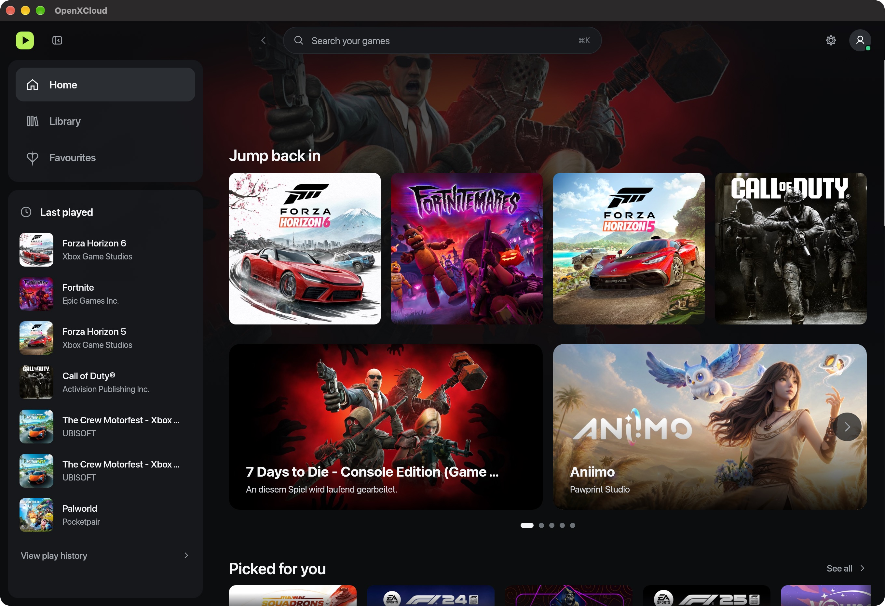

<div align="center">

# OpenXCloud

**Xbox Cloud Gaming, right on your desktop.**

A native Rust client with a game-first library, GPU upscaling, and streaming stats you can actually use.

[Features](#made-for-playing) · [Get started](#get-started) · [Platform support](#platform-support) · [Contributing](CONTRIBUTING.md)

</div>



<p align="center"><sub>A screenshot of the running macOS app. Game artwork belongs to its respective owners.</sub></p>

## Made for playing

- **Your next game, easy to find.** Browse the cloud library, search by name, and narrow the list by genre, player count, touch support, or game features.
- **Pick up where you left off.** Recently played games live in the sidebar. Save favourites with a heart and get recommendations based on what you play.
- **Choose your output resolution.** Upscale to **1080p, 1440p, or 4K** with AMD FSR 1.0 or optional Apple MetalFX. Adjust sharpness and change the target while playing.
- **See what the stream is doing.** Check FPS, bitrate, network latency, and decode/GPU timings. Expand the overlay for recovery counters and 60-second performance graphs.
- **Play with your preferred controls.** Use a supported controller with rumble, or the keyboard's virtual-controller mapping. Tune deadzones, triggers, and button layout.
- **A native streaming stack.** webrtc-rs handles transport, H.264 and Opus handle video and audio, and wgpu renders the stream. Credentials stay in the operating system's credential store.

## Get started

**The first release is in preparation.** For now, build from source. Signed, self-contained installers are still pending.

You'll need a Microsoft/Xbox account with access to the games you want to stream and a working internet connection. Cloud availability depends on the game, account, and region.

### Build on macOS

Install [Rust through rustup](https://rustup.rs/) and the native build dependencies. From this repository's checkout:

```sh
brew install ffmpeg cmake pkg-config llvm
cargo run --locked --release -p xcloud-app
```

To include Apple's MetalFX upscaler:

```sh
cargo run --locked --release -p xcloud-app --features metalfx
```

Rustup selects the version pinned in [`rust-toolchain.toml`](rust-toolchain.toml). The built application binary is `target/release/openxcloud`.

See the [packaging guide](PACKAGING.md) for Linux prerequisites and native packages. GitHub Actions produces macOS `.app` archives and Linux `.deb` artifacts. Development binaries still require their native runtime libraries.

### Start playing

1. Open OpenXCloud and complete Microsoft device-code sign-in.
2. Pick a game from your library and press **Play**.
3. Open **Settings → Video & upscaling** to choose the upscaler and output resolution.
4. Enable the performance overlay with **⌘⇧I** on macOS or **Ctrl+Shift+I**. Expand **Detailed stats** for graphs and counters.

Local upscaling preserves the source aspect ratio and never downscales a larger source. Streaming resolution and local output resolution are separate settings.

## Platform support

| Platform | Current status | Video path |
| --- | --- | --- |
| **macOS** | Primary development platform; app packaging available; signing and clean-machine validation pending | VideoToolbox with FFmpeg fallback; FSR 1.0 and optional MetalFX |
| **Linux** | Workspace compilation checked; desktop and live-stream validation ongoing | FFmpeg and wgpu; FSR 1.0 |
| **Windows** | Implementation present; native desktop build and playback validation pending | FFmpeg and wgpu; FSR 1.0 |

The repository includes desktop CI checks for macOS/Linux and transport tests for all three platforms. Build and loopback checks are only part of release validation.

## Under the hood

OpenXCloud uses **Rust**, **egui/eframe**, **wgpu**, and **webrtc-rs**. The workspace separates authentication, protocol handling, transport, media decoding, rendering, and input so each part can be tested independently.

- [Contributor guide](CONTRIBUTING.md) — workspace structure and development checks.

Bug reports are welcome. Include the app version, OS/GPU, and steps to reproduce. Review logs before sharing them and leave out credentials and account information.

## Licence

OpenXCloud is licensed under **[GPL-3.0-only](LICENSE)**. Third-party components retain their respective licences; see [third-party notices](THIRD_PARTY_NOTICES.md).

OpenXCloud is an independent project, unaffiliated with Microsoft or Xbox. Xbox and game names, logos, and artwork belong to their respective owners.
